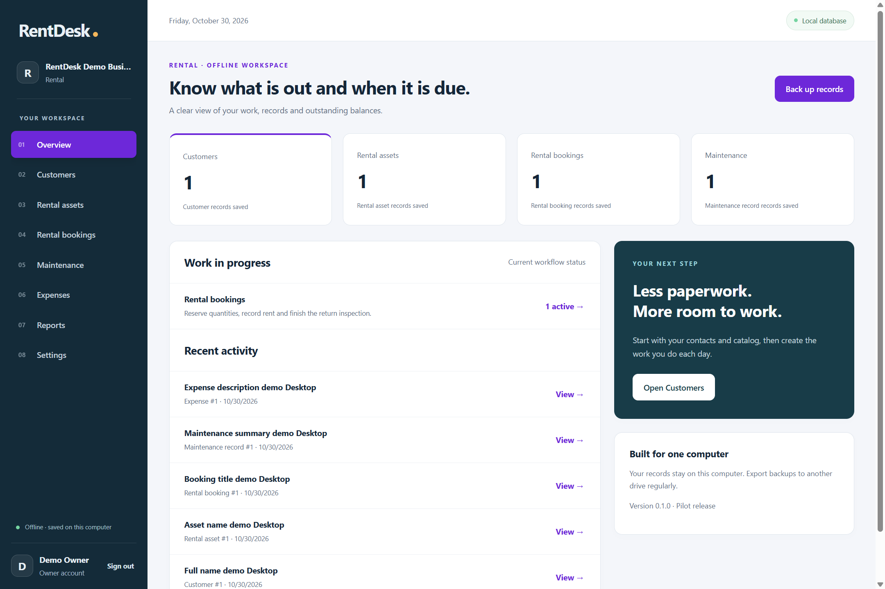
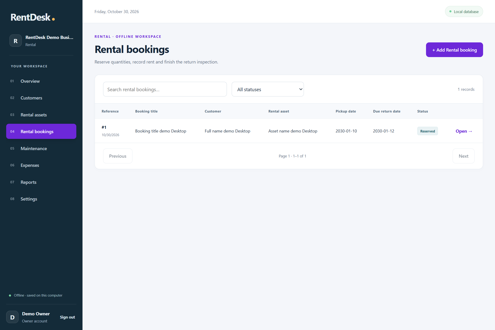
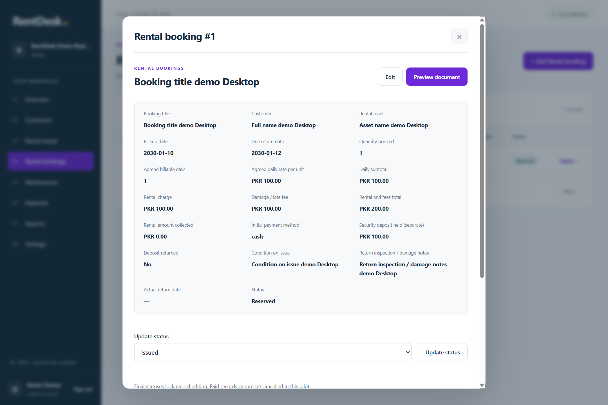
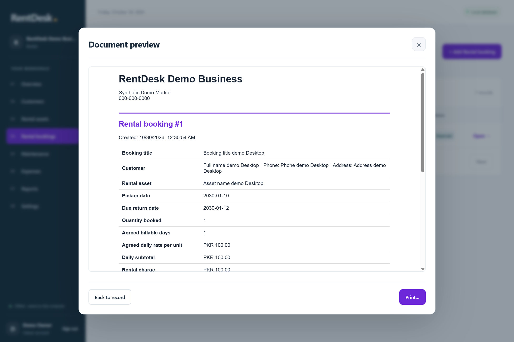
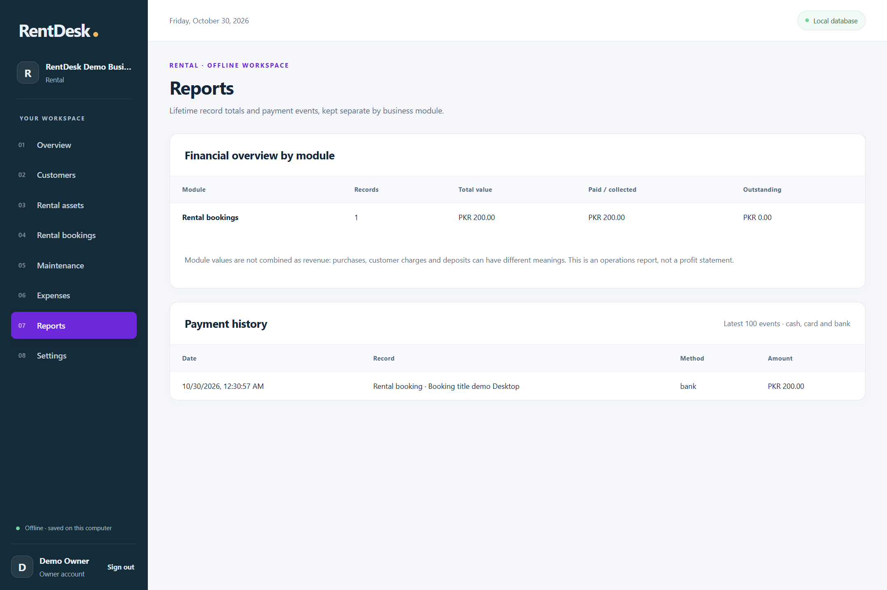

# RentDesk

**Know what is out and when it is due.**

Offline asset availability, date reservations, rental charges and return records for equipment, tools and dresses.

An offline Windows desktop pilot for one owner on one computer. Configure your own business; no default accounts, private shop data or seeded transactions are included. Version **0.1.0**.

## Screenshots

Captured from the desktop app with a fictional business and synthetic records only.



<details>
<summary>See the workspace, record, document preview and reports</summary>









</details>

## Install

Download the Windows x64 installer from [Releases](https://github.com/hassan-pk/rentdesk/releases), install, and create your local owner account. The installer is unsigned; Windows may show an unrecognized-publisher warning. Test on your computer and printer before using for real business.

Start by adding the master records (contacts, catalog or resources), then create your business transactions. Use **Open** to see record details, update progress, record payments or preview/print documents. See [BUSINESS.md](BUSINESS.md) for this application's workflow and limits.

## Modules

- **Customers**: Contacts and notes for repeat business.
- **Rental assets**: Set the available quantity and standard daily rate.
- **Rental bookings**: Reserve quantities, record rent and finish the return inspection.
- **Maintenance**: Record asset servicing separately from customer rental collections.
- **Expenses**: Record operating costs separately from customer bills.

## Common capabilities

- Business identity, local password-protected owner account and password changes.
- Searchable records, status filtering, pagination and business-specific forms.
- Initial advances and later payments with cash/card/bank event history; overpayments are rejected.
- Offline image attachments where the business form supports them.
- A4 document preview and Windows printer dialog.
- Per-module financial summaries; supplier payments are not mixed with customer revenue.
- SQLite persistence, automatic local backups, validated export/restore and recovery copies. Other apps' backups are rejected.

## Data and backups

Data is saved outside the install folder at `%APPDATA%/RentDesk/business.sqlite`. Uninstall preserves it. Automatic copies run at startup, hourly and on exit; the latest per UTC date is retained for 30 dates. Export copies to another drive regularly. Files/backups are not encrypted; use Windows and disk security to protect them.

Restore replaces records and accounts, saves a recovery copy and signs out. Use the password stored in the restored backup. Password recovery requires a known backup; there is no default password or reset backdoor. Export a backup before upgrades, and close the app before manual database operations.

## Build and test

Use Node.js 24+ and npm on Windows.

```powershell
git clone https://github.com/hassan-pk/rentdesk.git
cd rentdesk
npm ci
npm start
```

- `npm run build`: type-check and compile.
- `npm test`: isolated store, print and business-configuration regressions.
- `npm run test:desktop`: actual desktop workflow test with temporary records.
- `npm run dist`: Windows installer in `release/`.

No tests use your normal data directory. `BUSINESS_DATA_DIR` can explicitly select an isolated directory. Printing is checked as HTML and simulated native calls, not actual physical output.

## Pilot limits

- Capacity checks use inclusive pickup/return dates; Returned and Cancelled no longer reserve capacity. No hourly rentals or serial-number assignment.
- Billable days and agreed rate are manual. Record late/damage fees and actual return date yourself; penalties are not calculated automatically.
- Security deposits are informational custody fields, not rent income, payment-ledger entries, refunds or automated liability accounting. Reconcile deposits separately.
- Maintenance does not automatically block bookings. Adjust asset capacity and review existing reservations when taking units out of service.
- Returned records are terminal: enter final charges, inspection and deposit state before returning. One owner and one computer.
- One owner account; no cashier role, networking or cloud sync in this pilot.
- No partial refunds or paid cancellation. Finished records are locked; settle outstanding balances through payments.
- Reports are lifetime operations summaries, not audited accounting or profit statements.
- Physical printing, second-computer installation and a real trading-day pilot still require verification.

## Source structure and license

`business.json` defines the application modules. `src/business.json` is its compiled source copy; keep both in sync when changing configuration. `src/main/` owns storage/security and native operations, `src/renderer/` owns the interface, and `src/shared/` contains typed models and printing. The shared implementation is included here so this repository builds independently.

MIT licensed; see [LICENSE](LICENSE). Dependencies retain their upstream licenses; Electron distributions include third-party notices. Use synthetic records when reporting issues; never attach private business databases.
